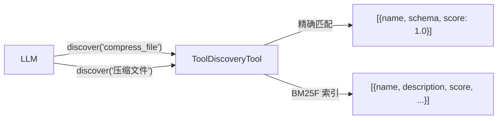

# 工具发现

当注册表包含数十甚至数百个工具时，在初始提示中发送所有工具 schema 会浪费 token 并降低 LLM 性能。**ToolDiscoveryTool** 允许 LLM 通过精确名称查找或自然语言查询按需发现相关工具，底层使用 BM25F（带字段加权的最佳匹配 25）稀疏搜索。

???+ note "更新日志"
    新增于版本：0.7.0（[#108](../../pull/108)）
    更新于：[#114](../../pull/114) — `enable_tool_search()`、`include_deferred`、搜索结果包含 schema
    更新于：[#118](../../pull/118) — 重命名为 `ToolDiscoveryTool` / `discover_tools`，新增精确匹配、`get_deferred_summaries()`

## 概览



ToolDiscoveryTool 支持两种模式：

1. **精确匹配** — 如果查询与已注册工具名完全匹配，立即返回完整 schema（score 1.0）。
2. **模糊搜索** — 否则执行 BM25F 多字段搜索。

为每个工具索引五个字段，支持可配置权重：

| 字段 | 默认权重 | 来源 |
|------|---------|------|
| `name` | 3.0 | 工具名称（下划线转空格） |
| `description` | 2.0 | 工具文档字符串 / 描述 |
| `search_hint` | 2.0 | `ToolMetadata.search_hint` |
| `tags` | 1.5 | `ToolMetadata.tags` + `custom_tags` |
| `params` | 1.0 | JSON schema 中的参数名 |

## 快速开始

最简单的启用方式是通过 `enable_tool_discovery()`，它会将 `discover_tools` 注册为 registry 中的可调用工具，让 LLM 可以自主发现工具：

```python
from toolregistry import ToolRegistry

registry = ToolRegistry()

@registry.register
def add(a: float, b: float) -> float:
    """Add two numbers together."""
    return a + b

@registry.register
def read_file(path: str) -> str:
    """Read the contents of a file from the filesystem."""
    return open(path).read()

# 启用工具发现 — 注册 "discover_tools" 为可调用工具
registry.enable_tool_discovery()

# LLM 在 get_schemas() 中可以看到 discover_tools 并调用它来发现工具
schemas = registry.get_schemas(include_deferred=False)
```

也可以在构造时启用：

```python
registry = ToolRegistry(tool_discovery=True)
```

### 发现模式

默认情况下，工具发现会跟随 deferred 集合。`registry.tool_discovery_mode` 为
`"auto"` 时：

- 注册一个 `ToolMetadata(defer=True)` 的工具会在同一次操作中开启工具发现，
  `discover_tools` 与 `call_deferred` 随之注册；
- 撤销最后一个 deferred 状态——注销该工具、取消 defer，或禁用它——工具发现会再次关闭。

`enable_tool_discovery()` 与 `disable_tool_discovery()` 则会把模式固定为 `"on"` 与
`"off"`。显式选择不会被之后的注册覆盖：开启的注册表在最后一个 deferred 工具消失后仍保持开启；
关闭的注册表在注册 deferred 工具后仍保持关闭——在重新启用之前，这些工具对模型不可达。
也可以直接选择：

```python
registry.set_tool_discovery_mode("auto")   # 跟随 deferred 集合（默认）
registry.set_tool_discovery_mode("on")     # 始终开启
registry.set_tool_discovery_mode("off")    # 始终关闭
```

关闭工具发现会为这两个工具各发出一个 `UNREGISTER` 变更事件，因此任何镜像注册表的组件——
MCP 服务器背后的路由表、OpenAPI 文档——都会刷新它所公布的内容，而不会保留注册表中已不存在的工具。

### 独立使用

如果你更想直接使用 `ToolDiscoveryTool` 而不将其注册到 registry 中：

```python
from toolregistry import ToolRegistry
from toolregistry.tool_discovery import ToolDiscoveryTool

registry = ToolRegistry()
# ... 注册工具 ...

discoverer = ToolDiscoveryTool(registry)

# 精确匹配 — 返回完整 schema
results = discoverer.discover("read_file")
print(results[0]["schema"])  # 完整工具定义

# 模糊搜索 — BM25 排序
results = discoverer.discover("read text file")
print(results[0]["name"])   # "read_file"
print(results[0]["score"])  # 1.23 (BM25 分数)
```

## 发现结果

每个结果是一个包含以下键的字典：

| 键 | 类型 | 说明 |
|----|------|------|
| `name` | `str` | 工具名称（标识符） |
| `description` | `str` | 工具描述 |
| `score` | `float` | BM25 相关性分数（精确匹配为 1.0） |
| `namespace` | `str \| None` | 工具命名空间（如有） |
| `deferred` | `bool` | 工具是否标记为延迟加载 |
| `schema` | `dict` | 完整工具 schema（精确匹配时总是包含；模糊搜索中仅延迟工具包含） |

**精确匹配**时，无论是否为延迟工具，结果始终包含完整 schema。**模糊搜索**时，仅延迟工具包含 schema，使 LLM 发现后可以立即调用。

若工具通过 `ToolMetadata(extra={"output_schema": ...})` 声明了返回结构——即服务端发布为 MCP `outputSchema` 的同一字段——发现结果也会在返回的 schema 中给出它，位置紧邻输入参数（OpenAI 风格定义位于 `function` 内，扁平的 `openai-responses`、Anthropic 与 Gemini 形式位于顶层）。缺少它时，模型只知道延迟工具需要什么参数，却不知道会返回什么，尽管工具确实返回结构化内容。

只有**已启用**的工具可被检索：在方法级或命名空间级被禁用的工具，会同时从 `discover_tools` 和 `get_deferred_summaries()` 中消失。`query` 必须是非空且非纯空白的字符串，`top_k` 至少为 1——生成的 schema 已声明这两点，运行时若仍收到非法值会抛出 `ValueError`。匹配针对每个工具的名称、描述、标签、参数名与 `search_hint`；对英文关键词的覆盖最好，中文查询通过字符二元组支持。

```python
results = discoverer.discover("email", top_k=3)
for r in results:
    print(f"{r['name']}: {r['score']:.2f} — {r['description']}")
    if r.get("schema"):
        print(f"  Schema: {r['schema']}")
```

### 相关性下限

模糊搜索结果会按照最佳命中进行相对裁剪：得分低于最高分 `min_score_ratio`（默认 `0.3`）的结果会被丢弃，因此当一个查询只有明确匹配时，不会再用仅仅共享某个词元的无关工具来填充。最佳命中始终保留；精确名称查找完全绕过该下限。

```python
# 更严格（只保留与最高分相差 50% 以内的命中）
registry.enable_tool_discovery(min_score_ratio=0.5)

# 关闭下限，返回原始 top_k 列表
registry.enable_tool_discovery(min_score_ratio=0.0)

# 独立对象上的同一参数
discoverer = ToolDiscoveryTool(registry, min_score_ratio=0.3)
```

该下限是**相对**的而不是绝对的：BM25 分数在不同查询之间不可比较（取决于语料规模、IDF 与查询长度），因此固定的绝对阈值会在小语料上丢掉有效结果、在大语料上留下噪声。当查询与任何工具都不太匹配时，近似并列的命中会被保留，而不是返回空列表——空列表会让模型无从继续。

### 查询词元过滤

由一个在语料中随处可见的词构成的查询并不构成一次有效的搜索。索引工具中出现比例达到 `max_df_ratio`（默认 `0.5`）的词元会在打分前被丢弃，因此 *"weather forecast for a city"* 中的 "for" 与 "a" 不再匹配每一个恰好包含它们描述的工具。若过滤会丢掉所有词元，搜索会回退到查询中的**能力词元**——即出现在至少一个工具名中的词——并保留其中最少见的一个；因此在同质语料上，*"file on disk"* 仍能命中 *"file"* 命中的那四个文件工具，而不是返回空结果。仅由样板词组成的查询（如 "the a of"）没有能力词元，仍返回空列表而不是近似并列的填充结果。

该过滤是语料自适应的——基于文档频率，而不是英文停用词表——因此对任何语言与领域词汇都适用。只有当词元出现在**至少三个已索引工具**中时才会被视为填充词，因此在小型注册表中、四个工具里有两点提到同一个词时，该词仍会被检索，而不会在 50% 边界上被丢弃。**单词查询从不被过滤**：单个词就是能力关键词，丢弃它会让该能力无法被发现。可通过 `max_df_ratio=0` 关闭：

```python
registry.enable_tool_discovery(max_df_ratio=0.0)
```

两个阶段是互补的：查询词元过滤移除匹配过宽的词，随后相关性下限丢弃远低于最佳命中的结果。

## 渐进式披露

大型 registry 的推荐工作流：

1. **将不常用的工具标记为延迟** — `ToolMetadata(defer=True)`
2. **使用 `get_schemas(include_deferred=False)`** 仅向 LLM 发送核心工具
3. **通过 `get_deferred_summaries()` 注入延迟工具摘要** 到 system prompt
4. **启用 `discover_tools`** 让 LLM 可以按名称或查询查找任何工具

```python
from toolregistry import Tool, ToolMetadata, ToolTag

registry = ToolRegistry(tool_discovery=True)

# 核心工具 — 始终可见
@registry.register
def add(a: float, b: float) -> float:
    """Add two numbers."""
    return a + b

# 延迟工具 — 按需发现
registry.register(
    Tool.from_function(
        compress_file,
        metadata=ToolMetadata(
            defer=True,
            tags={ToolTag.FILE_SYSTEM},
        ),
    )
)

# 1. 非延迟工具的 schema 用于 LLM tools 参数
schemas = registry.get_schemas(include_deferred=False)

# 2. 延迟工具摘要用于 system prompt
summaries = registry.get_deferred_summaries()
# [{"name": "compress_file", "description": "Compress a file into a zip archive.", "namespace": None}]
```

### 延迟工具摘要

`get_deferred_summaries()` 返回延迟工具名称及首句描述的轻量列表，适合注入到 system prompt 中：

```python
summaries = registry.get_deferred_summaries()
for s in summaries:
    print(f"- {s['name']}: {s['description']}")
```

每个摘要包含：

| 键 | 类型 | 说明 |
|----|------|------|
| `name` | `str` | 工具名称 |
| `description` | `str` | 工具描述的第一句话 |
| `namespace` | `str \| None` | 工具命名空间（如有） |

仅包含**已启用**的延迟工具。描述会截断到第一句话（第一行中首个 `. ` 之前的文本）。

### 通过 `call_deferred` 调用延迟工具

启用工具发现后，`call_deferred` 代理工具会与 `discover_tools` 一起注册。它为那些在初始化时缓存 `tools/list` 且无法动态注册新发现工具的 MCP 客户端提供了桥接方案。

工作流程如下：

1. LLM 调用 `discover_tools(query="search")` → 接收延迟工具的完整 schema
2. LLM 调用 `call_deferred(_target_tool="search", query="hello")` → 注册表通过完整管线（权限、执行后端、日志）执行延迟工具

`call_deferred` 仅接受延迟工具——对非延迟工具调用会抛出 `ValueError`。

`call_deferred` 是代理，而不是权限旁路：注册表先解析目标，再使用**目标工具的**参数走与直接调用相同的访问检查。
拒绝目标的策略同样会拒绝代理调用，包括依赖参数取值的规则。代理调用与被派发的调用都会出现在执行日志中。


工具名的匹配是宽松的。`discover_tools` 与 `call_deferred` 都会在把 `/` 和 `-` 折叠为 `_`、并忽略大小写之后解析名称，因此被 MCP 客户端改写过的名字（注册名为 `weather-get-current`，实际传入 `weather_get_current`）同样能命中正确的工具。精确的注册拼写优先于归一化匹配。没有工具匹配时，错误信息会列出最接近的注册名，便于调用方一次自我纠正。

`discover_tools` 和 `call_deferred` 通过 `enable_tool_discovery()` / `disable_tool_discovery()` 一起注册和注销。它们的名称可通过 `toolregistry.llm.discovery` 中的常量 `TOOL_DISCOVERY_NAME` 和 `TOOL_CALL_DEFERRED_NAME` 获取。

## 搜索提示

使用 `ToolMetadata.search_hint` 添加同义词、相关概念或领域特定术语，以提高工具的可发现性：

```python
registry.register(
    Tool.from_function(
        read_file,
        metadata=ToolMetadata(
            search_hint="open load text content cat",
        ),
    )
)
```

`search_hint` 字段的索引权重为 2.0（与 `description` 相同），因此这些关键词对排名的影响与工具自身描述一样强。

## 自定义字段权重

覆盖默认 BM25F 字段权重以调整排名策略：

```python
# 通过 enable_tool_discovery()
registry.enable_tool_discovery(field_weights={
    "name": 5.0,          # 提高精确名称匹配权重
    "description": 1.0,
    "tags": 3.0,          # 提高基于标签的发现权重
    "params": 0.5,
    "search_hint": 2.0,
})

# 或通过独立的 ToolDiscoveryTool
discoverer = ToolDiscoveryTool(
    registry,
    field_weights={
        "name": 5.0,
        "description": 1.0,
        "tags": 3.0,
        "params": 0.5,
        "search_hint": 2.0,
    },
)
```

## 重建索引

在工具注册、注销、重新启用或更新时，索引会**自动重建**，由 ChangeCallback 机制驱动。无论通过 `enable_tool_discovery()` 启用，还是直接构造 `ToolDiscoveryTool`，这一行为都成立：发现器会自行订阅注册表变更，并在下一次 `discover()` 时惰性重建，因此批量变更只需一次重建，而不是每个事件一次。无需手动干预：

```python
@registry.register
def new_tool(x: int) -> int:
    """A newly added tool."""
    return x * 2

results = discoverer.discover("newly added")
assert results[0]["name"] == "new_tool"
```

调用 `discoverer.close()` 可停止跟随注册表变更（幂等）；`disable_tool_discovery()` 会代为调用。`rebuild_index()` 仍可用于强制重建，例如就地修改工具元数据之后。

## 实现细节

ToolDiscoveryTool 使用 [zerodep](https://pypi.org/project/zerodep/) 的 `SparseIndex`（v0.2.2）的内置副本——一个纯 Python BM25/BM25F 实现，**零外部依赖**。索引完全存储在内存中，大小通常可忽略不计（100 个工具 ≈ 几 KB）。

BM25F 参数：

- `k1 = 1.5` — 词频饱和度
- `b = 0.75` — 文档长度归一化
- `delta = 1.0` — BM25+ 下限修正
